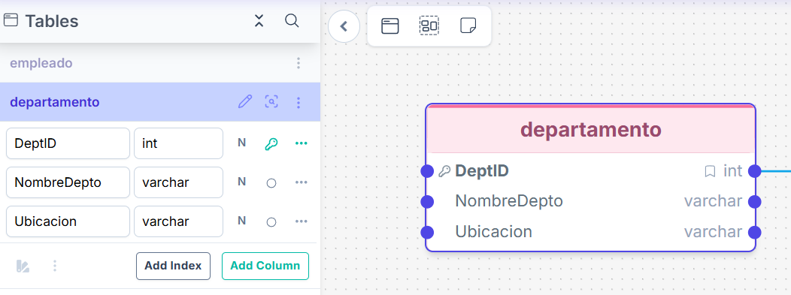
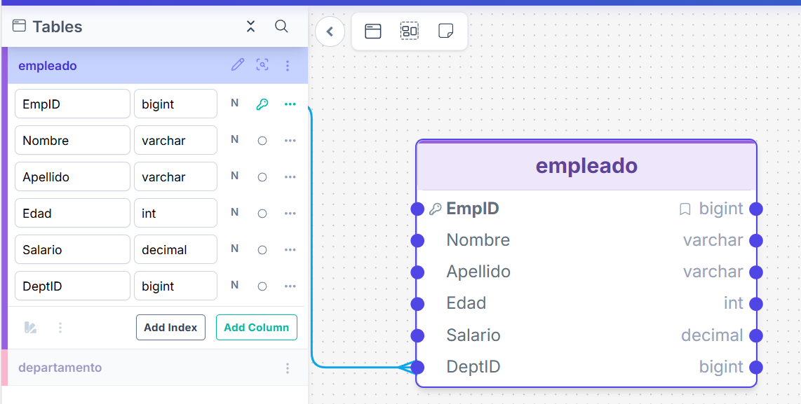
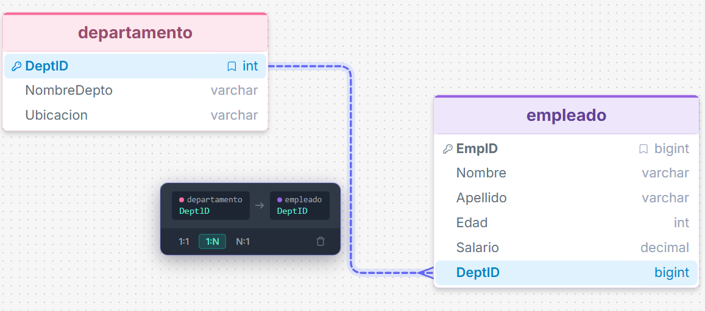
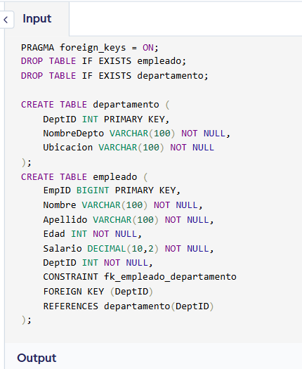
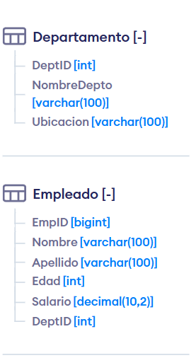
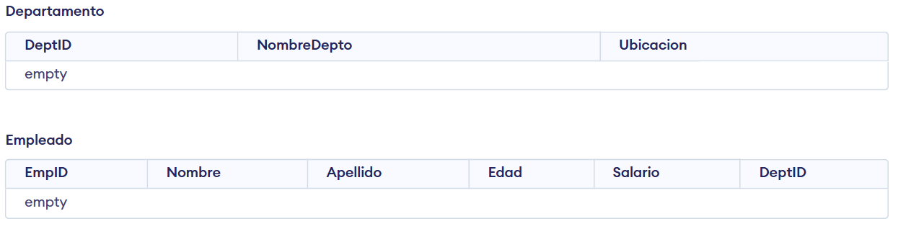

# Base de datos: Departamento y Empleado

Este proyecto representa la creación de una base de datos relacional con dos tablas principales:

- `departamento`
- `empleado`

La relación entre ambas es de tipo 1:N, donde un departamento puede tener muchos empleados, y cada empleado pertenece a un único departamento.

## 1. Diseño de la tabla `departamento`

En esta primera vista se define la estructura de la tabla `departamento`, con los campos:

- `DeptID` : identificador del departamento
- `NombreDepto` : nombre del departamento
- `Ubicacion` : ubicación física o sede



## 2. Diseño de la tabla `empleado`

En esta segunda vista se modela la tabla `empleado`, con los campos:

- `EmpID` : identificador del empleado
- `Nombre` : nombre del empleado
- `Apellido` : apellido del empleado
- `Edad` : edad del empleado
- `Salario` : salario del empleado
- `DeptID` : clave foránea que referencia al departamento



## 3. Relación entre `departamento` y `empleado`

La relación se define como una asociación de uno a muchos:

- Un departamento puede estar relacionado con varios empleados
- Cada empleado pertenece a un departamento



## 4. Script SQL de creación de tablas

A continuación se muestra el script SQL que crea ambas tablas y establece la llave foránea:

```sql
PRAGMA foreign_keys = ON;
DROP TABLE IF EXISTS empleado;
DROP TABLE IF EXISTS departamento;

CREATE TABLE departamento (
    DeptID INT PRIMARY KEY,
    NombreDepto VARCHAR(100) NOT NULL,
    Ubicacion VARCHAR(100) NOT NULL
);

CREATE TABLE empleado (
    EmpID BIGINT PRIMARY KEY,
    Nombre VARCHAR(100) NOT NULL,
    Apellido VARCHAR(100) NOT NULL,
    Edad INT NOT NULL,
    Salario DECIMAL(10,2) NOT NULL,
    DeptID INT NOT NULL,
    CONSTRAINT fk_empleado_departamento
    FOREIGN KEY (DeptID)
    REFERENCES departamento(DeptID)
);
```



## 5. Estructura final del modelo

Una vez creado el esquema, la base de datos queda organizada de la siguiente manera:

- `departamento`: almacena los departamentos
- `empleado`: almacena los empleados y su relación con cada departamento



## 6. Vista de las tablas vacías

Al iniciar la base de datos, ambas tablas quedan creadas pero sin registros todavía. Esta es la vista inicial antes de insertar datos:



## Resumen

Este modelo es un ejemplo claro de una base de datos relacional con normalización básica:

- La información de departamentos se guarda en una sola tabla.
- Los empleados se guardan en otra tabla.
- La relación se hace mediante `DeptID` en la tabla `empleado`.

Esto permite consultar fácilmente a qué departamento pertenece cada empleado, además de mantener la integridad referencial de la base de datos.
